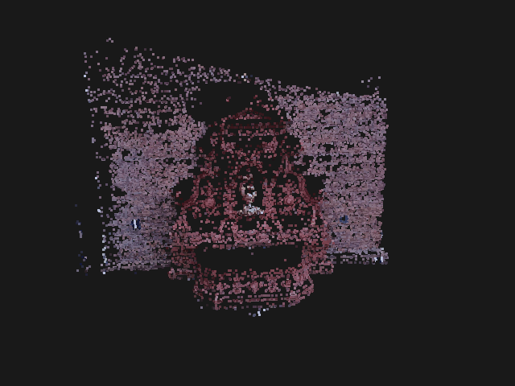

# Multi-view 3D Reconstruction

Turns a set of overlapping photos into a colored 3D point cloud (sparse
structure from motion), using OpenCV, pycolmap (COLMAP), and Open3D.



*fountain-P11, 11 photos: 11/11 cameras registered, ~15,000 points.*

## What it does

1. **Load** photos and the camera intrinsics K (`K.txt`), or build K from
   the photo EXIF data for your own phone photos.
2. **Match features**: SIFT keypoints matched between photos, filtered with
   the ratio test and RANSAC.
3. **Structure from motion** (pycolmap): estimates each camera's position,
   triangulates 3D points, and refines everything with bundle adjustment.
4. **Clean up** the point cloud (outlier removal, optional floor/table removal).
5. **Export**: `.ply` point cloud, turntable GIF, and a metrics file.

## Results (fountain-P11)

| Metric | Value |
|---|---|
| Images registered | 11 / 11 |
| 3D points (after cleanup) | ~15,100 (~14,870) |
| Mean reprojection error | 0.23 px |
| Mean track length | 4.8 views per point |
| Runtime (CPU, 1600 px images) | ~33 s |

Pairwise matching on the same images (Step 2 diagnostic): neighbouring views
share 1,000-1,800 RANSAC inliers ([inlier matrix](results/sample/inlier_matrix.csv),
[match picture](results/sample/matches_0001_0002.jpg)).

## Setup (Windows, PowerShell)

Requires Python 3.12. Open3D and pycolmap do not reliably ship wheels for the
newest Python versions.

```powershell
py -V:Astral/CPython3.12.13 -m venv .venv   # or any Python 3.12: py -3.12 -m venv .venv
.\.venv\Scripts\Activate.ps1
python -m pip install -r requirements.txt
```

## How to run

**Sample dataset** (folder with photos and a `K.txt`):

```powershell
python run.py --images data/sample --out results/sample
python view.py results/sample/sparse_clean.ply
```

**Your own photos** (no `K.txt`): K comes from the EXIF focal length and is
refined during bundle adjustment. Photos are rotated upright from EXIF and
downscaled to 1600 px.

```powershell
python run.py --images <photo folder> --out results/<name> --k-from-exif
python run.py --images <photo folder> --out results/<name> --k-from-exif --remove-plane
```

Tips for your own photos: 20-40 photos walking around the object, each sharing
~60-80% of its view with the next; textured, matte subjects; even lighting;
fixed zoom. `--remove-plane` removes the largest flat surface (a table or floor).

**Outputs** in `--out`:

| File | Contents |
|---|---|
| `sparse.ply` | raw point cloud |
| `sparse_clean.ply` | outliers removed |
| `turntable.gif` | 360° spin of the clean cloud |
| `metrics.json` | images registered/total, points, reprojection error, runtime |

**Other tools**:

```powershell
python -m src.check_data --data data/sample                          # sanity-check a dataset folder
python -m src.match_pairs --data data/sample --out results/sample    # pairwise matching diagnostic
python tests/smoke_test.py                                           # end-to-end smoke test (~40 s)
```

## Project layout

```
run.py              one command: photos -> point cloud, GIF, metrics
view.py             open a .ply in the Open3D viewer
src/data_loader.py  images + K.txt loading, downscaling
src/photos.py       own photos: EXIF rotation and EXIF-based K
src/features.py     SIFT, FLANN, ratio test, RANSAC (Step 2 diagnostic)
src/match_pairs.py  all-pairs matching script
src/sfm.py          pycolmap reconstruction, export, metrics
src/cleanup.py      outlier removal, far-point crop, plane removal
src/render.py       turntable GIF (Open3D offscreen, matplotlib fallback)
src/check_data.py   dataset sanity check
data/               input photos (not in git, except K.txt)
results/            outputs
```

## Known limitations

- **Sparse only**: points exist only where features were matched, so surfaces
  look speckled and there is no mesh.
- **Scale is arbitrary**: coordinates are not in meters.
- **One camera model for all photos**: same camera, zoom, and resolution;
  pinhole model without lens distortion. Photos of a different size are dropped.
- **Own-photo K** assumes the principal point is at the image center. Without
  EXIF focal length it starts from a guess (f = 1.2 x max(w, h)) and relies on
  bundle adjustment to correct it.
- **Own-photo mode has only been tested on the sample photos with synthetic
  EXIF data**, not on real phone photos.
- **Exhaustive matching** compares every pair: fine for tens of photos, slow for hundreds.
- **CPU only**; HEIC photos must be converted to JPG first.
- The Step 2 matcher is a diagnostic; COLMAP runs its own feature matching.

## Future work

- **OpenCV-only pipeline with bundle adjustment**: COLMAP currently handles
  pose estimation and bundle adjustment; an own incremental pipeline
  (essential matrix, recoverPose, triangulation, PnP) plus least-squares bundle
  adjustment would remove the pycolmap dependency.
- **Dense reconstruction** (multi-view stereo) for full surfaces instead of sparse points.
- **Poisson surface mesh** from a dense, cleaned point cloud.
- **RGB-D mode**: depth-camera frames aligned with ICP, a pose graph for loop
  closure, then TSDF fusion into a mesh.

## Data

fountain-P11 (Strecha et al.), via the
[Yashas120/Multiview-3D-Reconstruction](https://github.com/Yashas120/Multiview-3D-Reconstruction) repo.
See [data/README.md](data/README.md).
